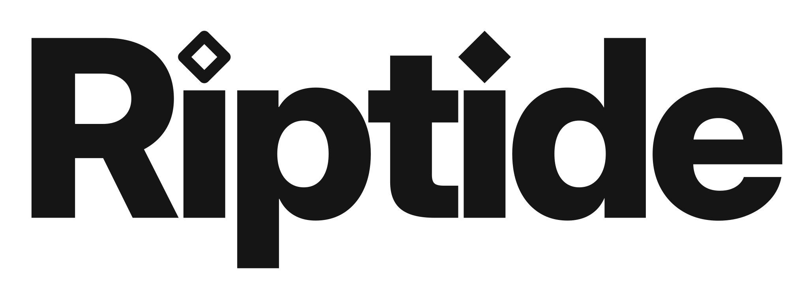

<p align="center">
  <picture>
    <source media="(prefers-color-scheme: dark)" srcset="brand/riptide-wordmark-white.svg">
    <source media="(prefers-color-scheme: light)" srcset="brand/riptide-wordmark.svg">
    
  </picture>
</p>

# Riptide

A browser motion-graphics and image editor with a small Flask backend for video export.

## Video mode
- Layers: rectangle, ellipse, polygon, star, arc, text, image; move, resize, snap to centre, hide/lock, reorder, duplicate, copy/paste
- Keyframe any property with 23 easing curves; edit text in place on the canvas
- Timeline: zoom (Ctrl/Cmd + wheel, slider, Fit), expandable per-property keyframe rows, layer in/out trim bars, slide layers in time, split at playhead (Cmd+K), markers (M), snapping to playhead/markers/keys/edits (hold Shift to bypass)
- Blend modes, colour adjustments (brightness, contrast, saturation, hue, grayscale, sepia, invert) and blur/shadow, all keyframeable
- 44 animation presets: click to apply at the playhead or drag onto a layer in the viewer or timeline
- Video clips as layers: import or drop MP4/WebM/MOV, trim with the layer bar, set Source in, animate/adjust/blend like any layer; frame-accurate in exports (clip audio is not included; add it as an audio track instead)
- Import by dropping files anywhere (onto the viewer to place them), pasting with Cmd+V, or dragging an image straight from another web page
- Resizable layers panel: drag its right edge for width and the bar under the layer list for height (double-click to reset)
- Drag with the middle mouse button to drag a copy: a layer on the canvas, a layer's bar in the timeline, or a keyframe. The original stays where it was
- Select several layers: Shift- or ⌘-click on the canvas or in the Layers panel (Shift-click there selects a range), drag a box on empty canvas, or ⌘A. Move, nudge, duplicate or delete them together
- Align and centre: an Align bar in the Design panel (one layer aligns to the canvas, several to each other), Centre on canvas (⌥C), distribute three or more evenly; also in the right-click menu
- Audio tracks: import as many files as you like, each on its own track (clips on different tracks play together). Drag clips in time or onto another track, trim their edges, split at the playhead (⌘K), delete with ⌫, and drag the dots at a clip's top corners to fade it in or out (drag back, or double-click a dot, to remove the fade). Everything is mixed into MP4/WebM exports
- 3D: turn any layer into a 3D layer (Rotate X and Y, Depth) from its Design panel; add lit 3D shapes (cube, sphere, cylinder, cone, torus, 3D text) with matte, glossy or metal finishes from the cube button in the toolbar; import .glb, .gltf or .obj models by dropping them in; and add a Camera layer to orbit, tilt, dolly, zoom and roll around it all. Everything animates, and the 3D animation presets (Flip, Swing in, Fly in, Turntable, Orbit around, Push in…) work on any 3D layer or the camera
- Export: MP4 (H.264/AAC), WebM (VP9/Opus), GIF, PNG sequence (zip), or a still frame; 24/25/30/60 fps; 50/100/200% size; whole timeline or between markers

## Image mode
Switch with Video / Image in the header. The timeline is hidden; importing an image into an empty canvas opens it at full resolution.
Adjust colour, apply looks (Vivid, Warm, Cool, Faded, Vintage, Noir, Mono, Punch, Negative), flip, blend layers, add shapes and text, then export PNG, JPEG or WebP.

## Install

Linux:

    curl -fsSL https://raw.githubusercontent.com/Natuworkguy/Riptide/main/install.sh | bash

Windows (PowerShell):

    irm https://raw.githubusercontent.com/Natuworkguy/Riptide/main/install.ps1 | iex

The installer puts Riptide in its own Python environment, adds a `riptide` command, an applications menu (or Start
menu) entry, and registers `riptide://open` links, which open the editor in your browser and start its server if it is
not running. `riptide --stop` stops that server. Run the installer again to update. `--dev` installs the dev branch,
where changes land first (on Windows: `& ([scriptblock]::Create((irm https://raw.githubusercontent.com/Natuworkguy/Riptide/main/install.ps1))) -Dev`),
and `--uninstall` (`-Uninstall`) takes Riptide back out. ffmpeg is still yours to install, for video export.

## Run

    brew install ffmpeg          # only needed for MP4/WebM/GIF export
    python3 -m venv .venv && .venv/bin/pip install -r requirements.txt
    .venv/bin/python server.py   # http://127.0.0.1:5173

Projects save as `.rip` files (images and audio embedded; older `.wob` files still open) with the browser's own Save/Open dialogs.

## Tutorial
Help in the header (or **F1**) opens a tutorial in 14 sections, from the first layer to 3D, the camera, exporting and working with an agent, with buttons that try each thing on the spot. It is offered once on a first visit.

## Shortcuts
Press **?** in the editor for the full list (80 commands), or **Cmd+P** for the command palette, which searches every
command, layer, animation preset and canvas size, and jumps to a time if you type one (`2.5s`).
Highlights: R O P S A W T add shapes and text · Tab / Shift+Tab cycle layers · H hide · L lock · 0-9 opacity ·
Alt+A/D/W/S/H/V/C align · Cmd+[ ] arrange · K key all · Shift+K remove keys · J / ; previous / next keyframe ·
E cycle easing · [ ] trim · Alt+[ ] slide layer · Cmd+K split · M marker · Shift+M / Alt+M jump markers ·
I / U layer start / end · Shift+Space play from start · F focus mode · Cmd+Shift+E save frame as PNG.

## Live MCP server (let agents see and edit the animation)

`mcp_server.py` is a stdio MCP server. It talks to `server.py`, which relays each request to the Riptide tab open in your
browser, so agents work on the live project: changes appear instantly, go into undo history, and nothing is saved
until you save. The **Live** badge over the viewer turns green when the tab is linked (amber while an agent is working).

1. `.venv/bin/pip install -r requirements.txt` (adds `mcp`)
2. Run `.venv/bin/python server.py` and open http://127.0.0.1:5173
3. Point your MCP client at the URL **http://127.0.0.1:5173/mcp** (streamable HTTP, served by server.py).
   Or, for clients that only do stdio:

```json
{ "mcpServers": { "riptide": {
    "command": "/path/to/riptide/.venv/bin/python",
    "args": ["/path/to/riptide/mcp_server.py"] } } }
```

Tools: `get_project`, `get_layer`, `list_capabilities`, `see_frame` (image of one moment), `see_frames` (contact sheet over time),
`add_layer`, `update_layer`, `set_keyframes`, `delete_keyframes`, `apply_preset`, `delete_layer`, `reorder_layer`,
`set_composition`, `new_project`, `set_playhead`, `select_layer`, `add_marker`, `undo`, `redo`, `get_project_json`.
Set `RIPTIDE_URL` if the editor is not at http://127.0.0.1:5173. With several tabs open, the newest one is used.

Snapping: dragging an object snaps its edges and centre to the canvas and to other layers, with red guide lines;
hold Alt or Cmd to move freely.

Canvas size: the Composition **Preset** menu has social (Instagram, Story/Reel, TikTok, Shorts, X, LinkedIn, Facebook),
video (720p to 4K, vertical, cinema) and web sizes, plus Custom. **Scale content** fits the existing design into the new
frame; **Keep size** only re-centres it. **Rotate** swaps width and height.

## Contributing

Work happens on the `dev` branch; `main` holds releases. See [CONTRIBUTING.md](CONTRIBUTING.md).

3D is drawn with [three.js](https://threejs.org) (MIT), bundled in `static/vendor/three`, with the Droid Sans Bold typeface (Apache 2.0) for 3D text.
